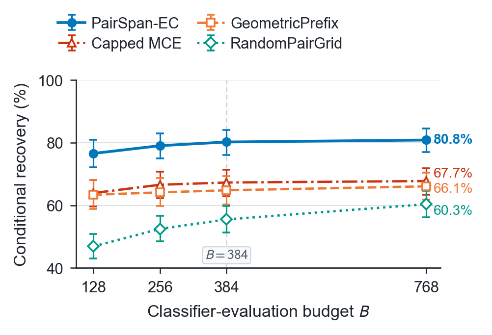

# PairSpan-EC

Finite-budget pair-span search for classifier-based prompt screening.

This repository provides the core implementation, de-identified experimental
measurements, and numerical reproduction scripts for **Finite-Budget Pair-Span
Search for Classifier-Based Prompt Screening**.

**Accepted at WSDM 2027, Main Conference; to appear.**

## Method

Erase-and-check screens a prompt by deleting token spans and classifying the
remaining text. When two adversarial blocks are inserted at separated
positions, deleting either block alone can leave the other block in place.
PairSpan-EC searches for useful span pairs within a fixed classifier-evaluation
budget, without training a new classifier.

1. **Collect single-span evidence.** Combine length-balanced geometric spans
   with proposals from one classifier-gradient pass, then score their deletion
   candidates using the harmful-label probability.
2. **Rank adaptive pairs.** Apply non-maximum suppression and pair
   non-overlapping spans, ranked by the sum of their single-span scores.
3. **Retain geometric coverage.** Interleave adaptive pairs with a deterministic
   geometric family, removing duplicate candidate texts.
4. **Share one budget.** Count the original prompt and every evaluated
   candidate against the same cap. Keep the paper's stage/prefix stopping rules.

The primary setting uses a fixed DistilBERT classifier, a known two-span
insertion mode, and white-box access for saliency proposals. The gradient pass
is reported separately from classifier evaluations.

## Evaluation Results

| HarmBench behaviors | Insertion lengths | Attack prompts | ShareGPT benign prompts |
| :---: | :---: | :---: | :---: |
| **159** | **15** | **2,385** | **500** |



*Recovery under the default decision rules at common maximum budgets. Error
bars are 95% base-prompt clustered bootstrap intervals; RandomPairGrid averages
five fixed orders. The vertical axis starts at 40%. [Figure source](assets/figures/README.md).*

The default comparison below uses 2,380 attacks that bypass the original
classifier. False-positive rates use the separate 500-prompt ShareGPT set
manually validated as benign. Checks are means over all 2,385 attack inputs.

| Method | Schedule | Recovery (%) | ShareGPT FPR (%) | Mean checks |
| --- | --- | ---: | ---: | ---: |
| GeometricPrefix | B384 | 64.79 | 21.40 | 258.3 |
| RandomPairGrid | B384, five orders | 55.48 | 21.00-21.80 | 258.3 |
| Capped MCE | B384 | 67.27 | 31.40 | 205.0 |
| PairSpan-EC, no saliency | B384 | 77.86 | 37.60 | 278.8 |
| **PairSpan-EC** | **B384** | **80.21** | **38.00** | **259.6** |
| RandEC-0.10 | Reference schedule | 73.32 | 22.40 | 321.6 |
| GreedyEC-10 | Reference schedule | 42.39 | 50.60 | 487.6 |
| GreedyEC-20 | Reference schedule | 53.70 | 56.80 | 847.5 |
| GradEC-50 | Reference schedule | 22.31 | 25.20 | 41.5 |

PairSpan-EC has higher default-rule recovery among the compared common-cap
policies, together with a higher benign false-positive rate. Cross-method
calibration changes the comparison: at an observed shared test FPR of
**6.20% (31/500)**, PairSpan-EC recovers **29.03%** and GeometricPrefix
**32.10%**. The repository retains both default and calibrated results.

The aggregate [JailbreakBench results](data/aggregate/jailbreakbench.csv)
also retain the external-attack boundary: on JBC-manual / Vicuna-13B,
PairSpan-EC detects 1/100 artifacts at B384, whereas reference-schedule
GreedyEC-20 detects 100/100 with 4,701.34 mean checks. These are artifact
classification results, not a common-cap or downstream-generation comparison.

## Maintenance

Maintained by Zhewei Shen ([@universe-szw](https://github.com/universe-szw)).
Use GitHub Issues for implementation, data-schema, or reproduction questions.
Final paper metadata will be added when available.

## Directory Structure

- `src/`: PairSpan-EC, EC controls, saliency, calibration, and statistical analysis.
- `data/`: de-identified measurements, aggregate evaluation tables, timing records,
  and [metric definitions](data/README.md).
- `reference/`: numerical targets used to check the reproduction outputs.
- `configs/`: classifier conventions and the paper's default parameters.
- `assets/figures/`: the paper's budget-recovery figure and source description.
- `tests/`: numerical validation, core-policy tests, and an offline inference smoke test.

## Numerical Records

The compressed score file contains **33,935 measurements**: 11 configurations
on 200 calibration requests, 500 benign test requests, and 2,385 attack inputs.
The calibration pool is filter-selected; the separate ShareGPT-500 evaluation
pool is human-validated.

| Fields | Meaning |
| --- | --- |
| `dataset_id`, `method_id`, `seed` | Evaluation population and method configuration. |
| `prompt_idx`, `insertion_t`, `request_id` | Dataset-scoped row identity; insertion length is null for benign inputs. |
| `base_group_id` | Ranked base-request group used for clustered attack statistics. |
| `base_harmful`, `default_harmful`, `ec_score` | Original classifier decision, EC decision, and recorded maximum harmful probability. |
| `classifier_checks`, `gradient_passes` | Measured classifier evaluations and separately recorded gradient passes. |

Original input texts, token sequences, model weights, and attack-generation
code are excluded. The supplied measurements support statistical recomputation;
aggregate-only evaluations are listed in [RESULT_MAP.md](RESULT_MAP.md).
Use `reference/operating_points.csv` for the published B384 default and
calibrated intervals. Some aggregate CSVs retain historical intervals; their
roles and units are specified in [data/README.md](data/README.md).
See [DATA_SCOPE.md](DATA_SCOPE.md) for dataset and verification scope.

## Quick Start Without a GPU or API Key

Use Python 3.10 or newer. Install NumPy, then run from the repository root:

```text
python -m pip install -r requirements.txt
python reproduce.py --output results
```

The command refits thresholds using only the 200 calibration requests,
recomputes recovery, false-positive rates, query costs, and 10,000-replicate
clustered intervals, and checks the outputs against the recorded paper values.
It also recomputes timing summaries from all five archived repetitions.
Execution is offline once the dependency is installed.

Outputs include `fit/thresholds.json`, `evaluation/operating_points.csv`,
per-length results, paired differences, timing summaries, and `verification.json`.
Use a new or empty output directory. Invalid records or numerical mismatches stop execution.
Recomputing recorded measurements is distinct from rerunning model inference
or measuring new hardware latency.

## Code Usage

Run the core policy on your own local classifier and inputs:

```text
python -m pip install -r requirements-inference.txt
python run_inference.py --model-dir /path/to/local/classifier --input examples/prompts.txt --output decisions.jsonl
```

The classifier directory must contain local Hugging Face tokenizer files and
safetensors weights, with `LABEL_0` meaning harmful and `LABEL_1` benign.
No model downloads or API calls are made. The runner outputs numeric decisions
and costs without saving input or deletion text.

The paper uses two insertion spans, maximum span length 64, and 384 classifier
evaluations. Classifier inference does not automatically truncate inputs; the
CLI rejects inputs exceeding the model context, counting special tokens.
Only the saliency gradient pass truncates at 512 positions. Settings are in
[configs/paper_settings.json](configs/paper_settings.json).
The original fine-tuned checkpoint is not distributed. Running the policy on
another compatible checkpoint does not reproduce the paper's measured rates.

The boolean `pairspan_ec` API raises if requested saliency fails. The diagnostic
`pairspan_ec_trace` API reports
`saliency_error_type`; callers must check that field before using its decision.
Set `use_saliency=False` only when deliberately running the no-saliency variant.

## Development

```text
python -B -m unittest discover -s tests -v
```

The NumPy-only environment runs numerical tests; core-policy and inference
tests additionally use `requirements-inference.txt`. The inference smoke test
creates a tiny random local classifier and harmless synthetic inputs. It does
not require the paper's model or data. Release verification is recorded in
[REPRODUCTION_REPORT.json](REPRODUCTION_REPORT.json).

See [ENVIRONMENT.md](ENVIRONMENT.md) for a pinned verification installation and
[RELEASE.md](RELEASE.md) for version notes.
[CI](https://github.com/universe-szw/pairspan-ec/actions/workflows/tests.yml)
checks numerical reproduction on Python 3.10/3.12 and pinned CPU inference tests
on Python 3.11.

## License and Reuse

Code and numerical measurement exports are distributed under the [MIT license](LICENSE).
The upstream erase-and-check attribution is retained in
[THIRD_PARTY_NOTICES.md](THIRD_PARTY_NOTICES.md). Source datasets and model
weights are not redistributed. Figure attribution and source information are in
[assets/figures/README.md](assets/figures/README.md).

## Citation

Zhewei Shen and Sha Yuan. **Finite-Budget Pair-Span Search for Classifier-Based
Prompt Screening.** Accepted at **WSDM 2027, Main Conference**; to appear.

Machine-readable paper and software metadata are in [CITATION.cff](CITATION.cff).
The DOI and proceedings link will be added when assigned.
